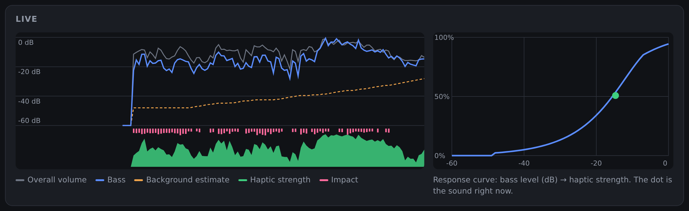
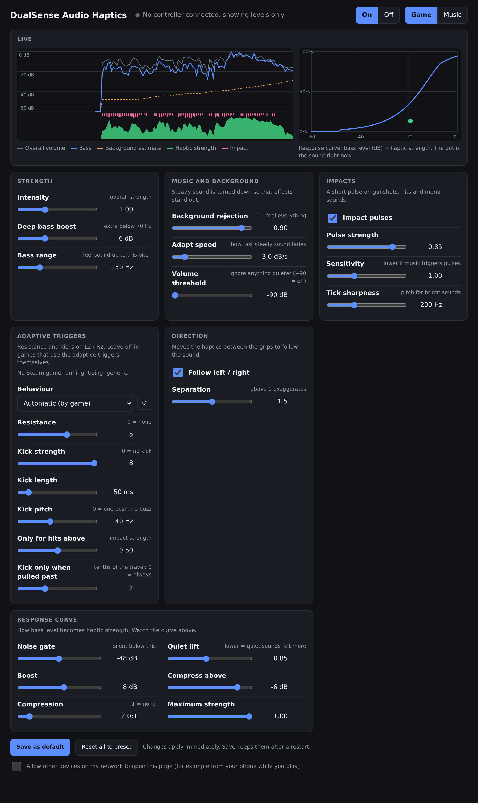
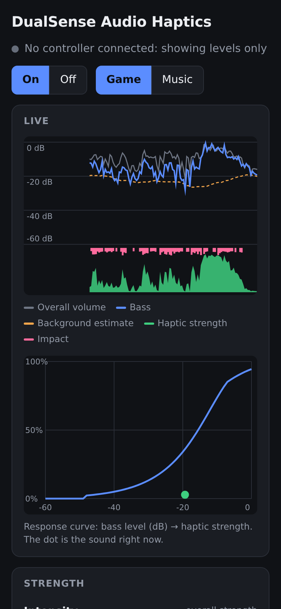
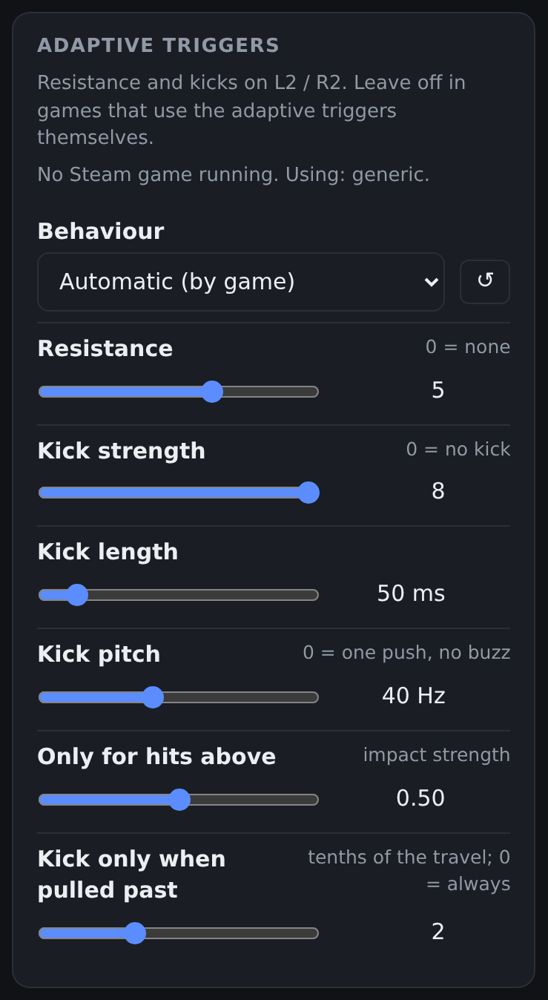

# ds5-audio-haptics

Feel your game's sound in a **Bluetooth DualSense** on Linux. A small background service
listens to whatever your Steam Deck or PC is playing and drives the controller's HD haptics
(the voice coils, not classic rumble) and, optionally, its adaptive triggers.



- **Works with any game**, no game support needed.
- **Bass, impacts and direction**: low frequencies become haptics, gunshots and hits add a
  sharp pulse, and the effect moves between the grips to follow the sound.
- **Keeps music out of the way**: steady background sound is turned down so effects stand out.
- **Adaptive triggers** (optional): gun-trigger click and recoil in shooters, brake and
  throttle feel in racing games, chosen automatically from the running Steam game.
- **Settings page** with live graphs, usable from your phone while you play.
- **No root, no kernel module**: everything lives in your home directory and survives SteamOS
  updates. Coexists with Steam Input.

## Install

You need x86-64 Linux with PipeWire, a DualSense connected over **Bluetooth**, and Steam (or
your distribution's `steam-devices` package) installed, which grants access to the controller.

```sh
curl -L https://github.com/ruimartin/ds5-audio-haptics/releases/latest/download/ds5-audio-haptics-x86_64-linux.tar.gz | tar xz
ds5-audio-haptics/install.sh
```

On a Steam Deck, run this in Desktop Mode (Konsole). The service starts at every login and
keeps running in Gaming Mode. Play something and you should feel it.

- Check: `ds5-audio-haptics status | grep '"output"'` should name your controller.
- Remove: `ds5-audio-haptics/install.sh uninstall` (your settings file is kept).
- If a command is not found, use its full path: `~/.local/bin/ds5-audio-haptics`.

## Settings page

Open **DualSense Audio Haptics** from the application menu, or run `ds5-audio-haptics ui`.



- **Live** shows the last 12 seconds: volume, bass, what is being treated as background, the
  haptic strength sent, and each detected impact. It works without a controller connected.
- **Response curve** shows how bass level becomes haptic strength; the dot is the sound now.
- Changes apply immediately. **Save as default** keeps them; **↺** returns one setting to the
  preset. **Game / Music** switches preset: *Game* is punchy and rejects music, *Music*
  follows the bass line faithfully.

### From your phone



The easiest way to tune while playing. Tick **Allow other devices on my network** at the
bottom of the page, or run:

```sh
ds5-audio-haptics set lan=true
ds5-audio-haptics save
ds5-audio-haptics status | grep '"ui_'
#  "ui_lan":  "http://192.168.1.20:5757/"
#  "ui_name": "http://dsconfig-steamdeck.local:5757/"
```

Open either address on your phone. The `.local` name is announced by the service itself; if
your phone does not resolve it, use the numeric one.

There is no password: while this is on, anyone on your local network can change these
settings (nothing else is exposed). It is off by default, answers only private network
addresses, and refuses requests coming through other web sites.

<br clear="right">

### In Gaming Mode on a Steam Deck

Add the page to Steam once: in Desktop Mode, **Games → Add a Non-Steam Game…** and tick
**DualSense Audio Haptics**. In Gaming Mode it then opens full screen in Firefox (install it
from Discover if needed). Close it with **STEAM → Exit game**.

### Command line

```sh
ds5-audio-haptics set intensity=0.7      # any setting, applied immediately
ds5-audio-haptics set preset=music       # or game
ds5-audio-haptics set enabled=false      # pause
ds5-audio-haptics set lowpass_hz=default # back to the preset's value
ds5-audio-haptics save                   # keep across restarts
ds5-audio-haptics status                 # everything, as JSON
```

Settings are stored in `~/.config/ds5-audio-haptics/config.toml`. Every key is documented in
[config.example.toml](config.example.toml).

## The main settings

| Setting | Default | What it does |
|---|---|---|
| `intensity` | 1.0 | Overall strength |
| `bass_boost_db` | 6 | Extra strength below 70 Hz |
| `lowpass_hz` | 150 | Upper edge of the bass that is felt |
| `background_reject` | 0.9 | Turns down steady sound such as music. 0 = feel everything |
| `volume_threshold_db` | off | Ignores everything quieter than this. Useful when music is clearly quieter than effects; pick the value from the Live graph |
| `transient`, `transient_gain` | on, 0.85 | A short pulse on gunshots, hits and menu sounds, and its strength |
| `transient_sensitivity` | 1.0 | Lower it if music triggers pulses |
| `stereo`, `stereo_width` | on, 1.5 | Moves haptics between the grips with the sound; above 1 exaggerates |

## Adaptive triggers



**Off by default**, because a game that drives the adaptive triggers itself would conflict.
Pick a behaviour in the settings page or with `ds5-audio-haptics set trigger_profile=auto`.

| Profile | R2 | L2 |
|---|---|---|
| `shooter` | Gun trigger: click point, kick per shot | Light resistance, half the kick |
| `racing` | Throttle: light resistance, faint kick | Brake: firm resistance, moderate kick |
| `generic` | Kick on impacts | Kick on impacts |
| `auto` | Shooter or racing by the running game, generic otherwise | |

- A trigger is kicked only **while you are pulling it** (past 20% by default), so a controller
  lying on the table stays quiet.
- `trigger_resistance` and `trigger_strength` (0 to 8) scale the whole profile.
- `trigger_freq_hz = 0` makes the kick a single push instead of a short buzz.

**How `auto` recognises a game.** It reads the running game's Steam app ID and decides from
your own lists, then a built-in list of popular titles, then the game's Steam store tags
(FPS, Shooter, Racing, Driving…) as cached on disk by the Steam client. Nothing is looked up
online. Non-Steam games get `generic`.

```sh
ds5-audio-haptics game            # what the running game resolves to
ds5-audio-haptics game 1684930    # any app ID (the number in its store URL)
```

To override a game, add its ID to the config file:

```toml
[games]
shooter = [1234560]
racing = [1234570]
```

<br clear="right">

## Good to know

- **Music and effects cannot be truly separated**; they arrive as one stream. Background
  rejection is a heuristic: loud drum hits can get through, and after an intense moment
  louder music may be felt for a few seconds.
- **Everything on the default output is used**, including voice chat and videos.
- **Game rumble wins.** When a game rumbles through Steam Input the controller plays that,
  and audio haptics resume the moment it ends. Turn rumble off for a game in Steam Input if
  you prefer audio haptics only.
- **Steam Input is not disturbed.** Haptics reports carry no controller state, so lightbar,
  LEDs and volumes are never touched. Trigger profiles change the triggers and nothing else.
- **Direction is clearer for sharp sounds** than for low rumbles: the grips share one shell.
- **Trigger motors are audible**, and automatic fire above about 11 shots a second skips some.
- **The racing profile reacts to sound, not to the car**: fixed pedal resistance plus kicks on
  loud bumps, not real ABS feedback.
- **One controller at a time.** With several connected, set `device = "<its Bluetooth address>"`.

## What has been tested

| | |
|---|---|
| Steam Deck (SteamOS 3.9) with a DualSense over Bluetooth, alongside Steam Input | Works, used daily by the author |
| Controller sleep and reconnect | Works |
| Adaptive triggers, `shooter` profile | Works |
| Bazzite desktop | Installs and runs; little play time |
| `generic` trigger profile, switching profile by running game | Works, little play time |
| `racing` trigger profile | Unit-tested, **never tried in a game** |
| DualSense Edge | Recognised by the code, **never tested** |
| Rumble fallback (`mode = "rumble"`, classic rumble when HD haptics are unavailable) | **Never tested on hardware** |
| Following a change of output device | Designed for, **not verified** |
| USB connection | Not supported: over USB the controller is an ordinary audio device |

Latency has not been measured end to end. Inside the service, audio reaches the controller
write 0.1 ms after it arrives; capture, packet assembly and filtering add roughly 8 to 19 ms
before that, and Bluetooth plus the controller's own buffering come on top.

## Troubleshooting

| `ds5-audio-haptics status` shows | What to do |
|---|---|
| `"output": "none (no Bluetooth DualSense)"` | Press the PS button; a USB cable does not count. It is picked up within seconds |
| `"output": "none (… Permission denied)"` | Install Steam or your distribution's `steam-devices` package |
| `"capture": "cannot run pw-record …"` | Install PipeWire's command-line tools |
| `"output": "hd …"` but nothing is felt | Run the test tone below. If it works, raise `intensity` or set `background_reject=0` |
| `"output": "rumble …"` | HD haptics were unavailable and it fell back to classic rumble |

```sh
ds5-tone --freq 60 --amp 0.25 --secs 3     # test tone on both grips, no audio needed
ds5-tone --freq 160 --channel left         # left grip only
ds5-trigger --side right --ms 1000         # vibrate R2 for a second (hold it to feel it)
journalctl --user -u ds5-audio-haptics -e  # the service's log
```

## How it works

```
default output's monitor ──pw-record──▶ DSP ──▶ 3 kHz stereo, signed 8-bit ──▶ /dev/hidrawN
   (passive tap: adds no delay                      one 142-byte Bluetooth report
    to what you hear)                               every 10.67 ms
```

Audio is captured from the default output with `pw-record`, filtered down to the bass band,
shaped (gate, level curve, compressor, background rejection, impact pulses, panning) and sent
to the controller as Bluetooth output report `0x32`. Capture runs only while a controller is
connected or the settings page is open, and transmission stops after two seconds of silence.
Adaptive triggers use report `0x31` with only the trigger flags set.

The report formats, the evidence for each field and the hardware test results are in
[docs/PROTOCOL.md](docs/PROTOCOL.md); open risks in [docs/RISKS.md](docs/RISKS.md). The
`status` / `set` / `save` commands and the settings page share one JSON protocol, also
available on a local socket (`$XDG_RUNTIME_DIR/ds5-audio-haptics.sock`).

## Building

```sh
rustup target add x86_64-unknown-linux-musl
scripts/build.sh test     # unit tests
scripts/package.sh        # target/bundle/ds5-audio-haptics-x86_64-linux.tar.gz
scripts/deploy.sh user@host   # build, copy over SSH and install there
```

The binaries are static and need nothing at run time except `pw-record`. On SteamOS or
Bazzite, where there is no toolchain, `scripts/build.sh` uses a distrobox named `dsdeck-dev`
with rustup under `~/.local/share/dsdeck-dev` (override with `DS5_DISTROBOX`,
`DS5_TOOLCHAIN`). `ds5-audio-haptics render < in.f32 > out.s8` runs the DSP offline on raw
48 kHz stereo float audio, which is how the presets were tuned against game recordings.

## Credits

- The Bluetooth haptics report format is **Sdore's SAxense research**:
  <https://apps.sdore.me/SAxense> ([egormanga/SAxense](https://github.com/egormanga/SAxense)).
  This project would not exist without it.
- Nielk1, for the corrections and PS5 captures in SAxense issue #1 and for the trigger effect
  documentation.
- [awalol/DS5Dongle](https://github.com/awalol/DS5Dongle) for the haptics-only report variant.
- [loteran/DS5Dongle](https://github.com/loteran/DS5Dongle) for the idea of deriving haptics
  from game audio.
- [nowrep/dualsensectl](https://github.com/nowrep/dualsensectl) as the reference for setting
  triggers over Bluetooth.

No code was copied from these projects. Not affiliated with or endorsed by Sony; "DualSense"
and "PlayStation" are trademarks of Sony Interactive Entertainment Inc. Provided as is: it
sends undocumented reports to your controller, at your own risk.

## License

[Mozilla Public License 2.0](LICENSE)
