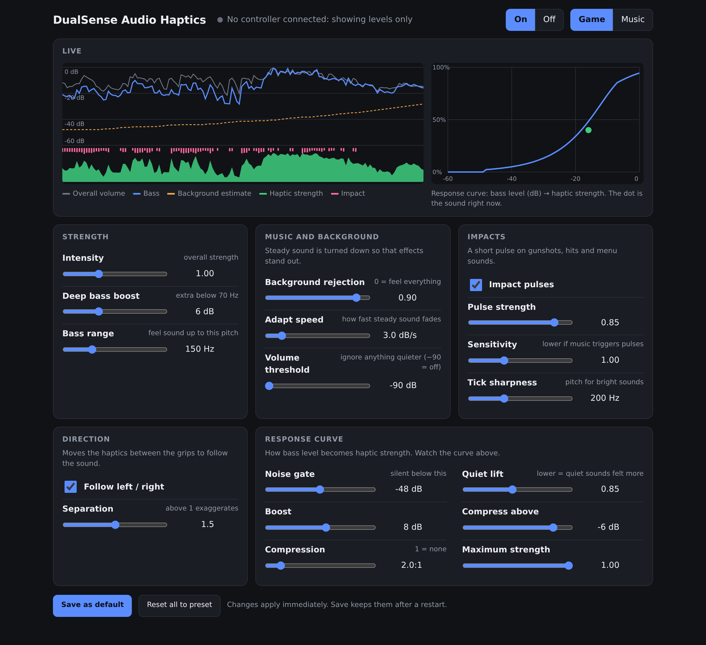
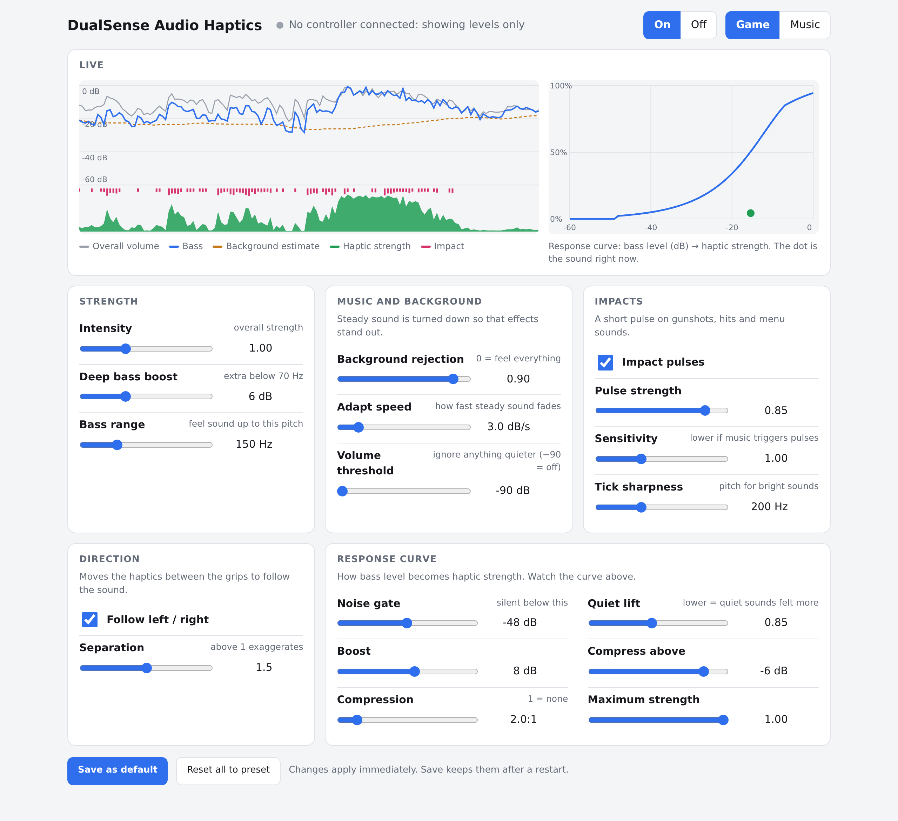

# ds5-audio-haptics

Feel your game's sound in a **Bluetooth** DualSense. A small background service listens to
whatever your PC or Steam Deck is playing and drives the controller's HD haptic actuators
(the voice coils, not classic rumble) from it: bass, gunshots and impacts, panned between the
two grips to follow the sound.



It works with any game, needs no game support, and runs entirely in your user account:
no kernel module, no root, nothing installed outside your home directory.

## Status

Personal project, early. What has actually been tested:

| | |
|---|---|
| Steam Deck (SteamOS 3.9), DualSense over Bluetooth | Works, used daily by the author |
| Alongside Steam Input (lightbar, LEDs, game rumble) | Works; see [Steam Input](#steam-input) |
| Controller going to sleep and reconnecting | Works |
| Bazzite desktop | Installs and runs; less play time than the Deck |
| DualSense Edge | Detected by the code, **never tested** |
| Rumble fallback (`mode = "rumble"`) | Written, **never tested on hardware** |
| USB connection | Not supported for HD haptics (over USB the controller is a normal audio device) |
| Following a change of output device (speakers / HDMI / headphones) | Designed for, **not yet verified** |
| Other distributions | Should work with PipeWire and BlueZ; untested |

End-to-end latency has not been measured physically. Inside the service, audio is written to
the controller 0.06 ms after it arrives (0.6 ms worst case seen); before that come about 5 ms
of capture, up to 10.7 ms of packet assembly and 3 ms of filtering. Bluetooth and the
controller's own buffering come on top and are unknown.

## Requirements

- x86-64 Linux with **PipeWire** (the `pw-record` tool) and **BlueZ**
- A DualSense paired and connected over **Bluetooth**
- Write access to the controller's `hidraw` node. Steam's udev rules provide this, so if Steam
  is installed you already have it (SteamOS, Bazzite and most distributions' `steam-devices`
  package).

## Install

```sh
curl -L https://github.com/ruimartin/ds5-audio-haptics/releases/latest/download/ds5-audio-haptics-x86_64-linux.tar.gz | tar xz
ds5-audio-haptics/install.sh
```

On a Steam Deck, do this in Desktop Mode (Konsole) or over SSH. The service then runs in
Gaming Mode too and starts by itself at every login. It survives SteamOS updates because
everything lives in your home directory:

| Path | What |
|---|---|
| `~/.local/bin/ds5-audio-haptics`, `~/.local/bin/ds5-tone` | static binaries |
| `~/.config/systemd/user/ds5-audio-haptics.service` | user service |
| `~/.config/ds5-audio-haptics/config.toml` | settings (created on first install, never overwritten) |
| `~/.local/share/applications/ds5-audio-haptics.desktop` | menu entry for the settings page |

Check that it found your controller:

```sh
ds5-audio-haptics status | grep -E '"(capture|output)"'
#  "capture": "running",
#  "output": "hd /dev/hidraw8 DualSense Wireless Controller (aa:bb:cc:dd:ee:ff)",
```

Then play something. If `~/.local/bin` is not in your `PATH`, call the tools by full path.

To remove it: `ds5-audio-haptics/install.sh uninstall` (your config file is kept).

### Quick hardware check

`ds5-tone` plays a plain test tone, independent of the service and of any audio:

```sh
ds5-tone --list                       # controllers found
ds5-tone --freq 60 --amp 0.25 --secs 3
ds5-tone --freq 160 --channel left    # left grip only
```

## Using it

### Settings page

The service serves a settings page on the machine it runs on. Open **DualSense Audio Haptics**
from the application menu, or run:

```sh
ds5-audio-haptics ui        # opens http://127.0.0.1:5757/
```



- **Live** shows the last 12 seconds: overall volume, the bass that is felt, what the service
  currently treats as background, the haptic strength being sent, and each detected impact.
  It works without a controller connected, so you can watch and tune before you feel anything.
- **Response curve** plots bass level against haptic strength; the dot is the sound right now.
  The sliders in the "Response curve" card reshape it.
- Every change applies immediately. **Save as default** keeps it across restarts; the ↺ next
  to a slider returns that one setting to the preset.

The page is only reachable from the same machine (it listens on 127.0.0.1 and refuses requests
coming from other web sites). On a Steam Deck, open it in Desktop Mode. Set `[ui] enabled =
false` in the config file to turn it off.

### Command line

The same settings can be changed from a terminal, also while a game is running:

```sh
ds5-audio-haptics set intensity=0.7        # overall strength (0..4)
ds5-audio-haptics set preset=music         # or: game (default)
ds5-audio-haptics set enabled=false        # pause; true to resume
ds5-audio-haptics set lowpass_hz=default   # back to the preset's value
ds5-audio-haptics status                   # everything, including current values
ds5-audio-haptics save                     # keep the running settings across restarts
```

`save` rewrites `config.toml` without its comments; `ds5-audio-haptics default-config` prints
a fresh commented one. Editing the file by hand works too, followed by
`systemctl --user restart ds5-audio-haptics`.

### The settings that matter most

| Key | Default (game) | What it does |
|---|---|---|
| `intensity` | 1.0 | Overall strength |
| `background_reject` | 0.9 | Turns down steady sound (music, engine drones) so that sounds standing out from it dominate. 0 = off: everything with bass is felt |
| `background_rise_db_s` | 3 | How fast a sustained sound becomes "background". Higher fades music sooner |
| `volume_threshold_db` | -90 (off) | Ignore everything quieter than this overall volume. Helps when a game's music is clearly quieter than its effects; watch the Live graph to pick a value |
| `bass_boost_db` | 6 | Extra strength below 70 Hz |
| `lowpass_hz` | 150 | Upper edge of the bass band that is felt |
| `stereo`, `stereo_width` | true, 1.5 | Pans haptics between the grips following the stereo image; width above 1 exaggerates |
| `transient` | true | Adds a short pulse on gunshots, impacts and menu blips |
| `transient_gain` | 0.85 | Strength of those pulses |
| `transient_sensitivity` | 1.0 | Lower it if music triggers too many pulses |

All keys, with comments, are in [config.example.toml](config.example.toml).

**Presets.** `game` is punchy: it rejects background music, emphasises impacts and pans.
`music` follows the bass line faithfully, in mono, with no rejection and lighter pulses.

### Known limits

- A game sends music and effects as one mixed stream, so they cannot be truly separated.
  `background_reject` is a heuristic: loud drum hits can still get through, and after an
  intense moment louder music can be felt for a few seconds until it is recognised as
  background again. Sustained gunfire is deliberately never faded.
- The two grips are mechanically coupled. Direction is clear for sharp sounds and vague for
  low rumbles.
- Everything playing on the default output is used, including voice chat and videos.

## Steam Input

Steam keeps the controller's `hidraw` node open and sends its own reports for the lightbar,
player LEDs, triggers and rumble. This service coexists with that:

- It only ever sends haptics reports (ID `0x32`) that contain no controller state, so it
  cannot change the lightbar, LEDs, mute light, triggers or volumes.
- When a game rumbles through Steam Input, the controller plays the rumble instead, and the
  audio haptics come back by themselves the moment the rumble ends. If you prefer audio
  haptics only, turn rumble off for that game in Steam Input.

## How it works

```
default output's monitor ──pw-record──▶ DSP ──▶ 3 kHz stereo signed 8-bit ──▶ /dev/hidrawN
   (48 kHz, passive tap,                              one 142-byte report
    adds no delay to what you hear)                   every 10.67 ms
```

1. **Capture.** `pw-record` taps the default sink's monitor, with no fixed target so that
   PipeWire can move it when the default output changes. Capture only runs while a
   controller is connected.
2. **DSP** (`src/dsp.rs`). High-pass, bass shelf and 4th-order low-pass at 48 kHz; decimation to
   3 kHz; one dynamics stage (gate, level curve, compressor, background rejection); an onset
   detector that adds a decaying pulse per impact, low-pitched for dull hits and sharper for
   bright ones; panning from the stereo balance above 300 Hz; soft limiter.
3. **Output** (`src/protocol.rs`, `src/service.rs`). Bluetooth output report `0x32` with a
   control sub-packet and a 64-byte haptics sub-packet, CRC-32 seeded with `0xA2`. After two
   seconds of silence it stops transmitting to save battery. The controller is found through
   sysfs and re-found after it sleeps or reconnects.

The report format, the evidence for each field and the hardware test results are written up in
[docs/PROTOCOL.md](docs/PROTOCOL.md); open risks are in [docs/RISKS.md](docs/RISKS.md).

A local control socket (`$XDG_RUNTIME_DIR/ds5-audio-haptics.sock`, one JSON object per line)
backs the `status` / `set` / `save` commands. The settings page posts the same JSON requests
to `/api`, and a future Decky Loader plugin would use the socket.

## Troubleshooting

| `status` shows | Meaning |
|---|---|
| `output: none (no Bluetooth DualSense)`, `capture: waiting for a controller` | Not connected, or connected by USB. Press the PS button; check `ds5-tone --list`. The service picks it up within a few seconds |
| `output: none (/dev/hidrawN: Permission denied …)` | No udev rule grants access. Install your distribution's `steam-devices` package, or Steam |
| `capture: cannot run pw-record …` | PipeWire's tools are not installed |
| `output: hd …` but nothing is felt | Run `ds5-tone`. If the tone works, raise `intensity` or set `background_reject=0`; if not, the controller is probably in rumble mode from another program |
| `output: rumble …` | HD output was unavailable and `mode = "auto"` fell back to classic rumble |

Logs: `journalctl --user -u ds5-audio-haptics -e`

## Building

The release binaries are static (musl) and have no runtime dependencies besides `pw-record`.

```sh
rustup target add x86_64-unknown-linux-musl
scripts/build.sh test     # unit tests
scripts/package.sh        # target/bundle/ds5-audio-haptics-x86_64-linux.tar.gz
```

On an image-based system without a toolchain (SteamOS, Bazzite), build inside a distrobox:
`scripts/build.sh` falls back to a box named `dsdeck-dev` with rustup installed under
`~/.local/share/dsdeck-dev` (override with `DS5_DISTROBOX` and `DS5_TOOLCHAIN`).

`scripts/deploy.sh user@host` builds, copies the bundle over SSH and installs it there.

`ds5-audio-haptics render < in.f32 > out.s8` runs the DSP offline on raw 48 kHz stereo float
audio, which is how the presets were tuned against recordings of real games.

## Credits

- The Bluetooth haptics report format is **Sdore's SAxense research**:
  <https://apps.sdore.me/SAxense> ([egormanga/SAxense](https://github.com/egormanga/SAxense)).
  This project would not exist without it.
- Nielk1's corrections and PS5 packet captures in SAxense issue #1.
- [awalol/DS5Dongle](https://github.com/awalol/DS5Dongle) for the haptics-only report variant
  and counters.
- [loteran/DS5Dongle](https://github.com/loteran/DS5Dongle) for the "Audio Auto Haptics" idea
  of deriving haptics from game audio.

No code was copied from these projects; the implementation here is independent.

Not affiliated with or endorsed by Sony. "DualSense" and "PlayStation" are trademarks of Sony
Interactive Entertainment Inc. Provided as is: it sends undocumented reports to your
controller, at your own risk.

## License

[Mozilla Public License 2.0](LICENSE)
